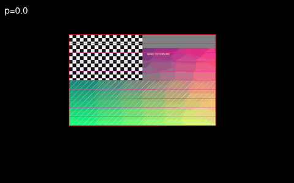
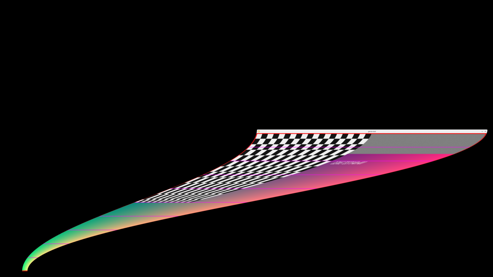
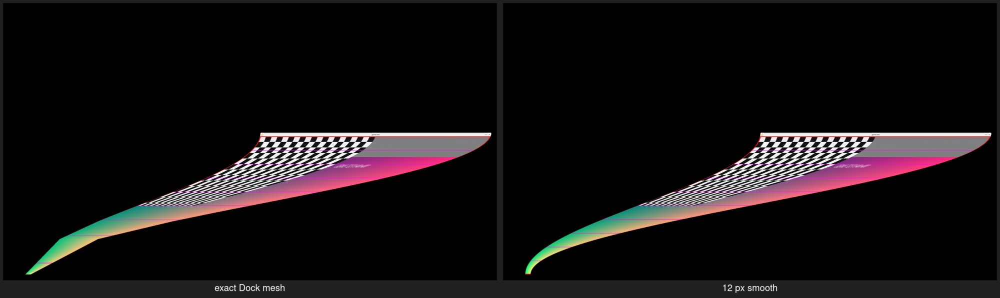

# Genie — macOS genie minimize effect for KWin

Native KWin effect plugin reproducing the macOS Tahoe genie minimize/restore animation. It appears
under **System Settings → Animations → Window minimize**.





The mesh generator is a bit-exact port of the Dock's genie routine, and rendering matches
WindowServer's per-cell projective texture mapping. By default the funnel is sampled densely enough
to avoid visible facets; set `GENIE_QUALITY=exact` for the original Dock mesh. Timing is 0.5 s;
hold **Shift** for 10× slow motion. Windows narrower or shorter than 5 pt use the Dock's scale
fallback instead of the genie mesh, as macOS does.

## Build

Needs `kwin-devel` (6.8), `extra-cmake-modules`, Qt 6 and KF6 CoreAddons development packages.

```sh
cmake -S . -B build -DCMAKE_BUILD_TYPE=Release
cmake --build build
sudo cmake --install build
```

Select **Genie** in System Settings → Animations → Window minimize.

After a rebuild, use `tools/reload_effect.sh`; KWin may keep the old library mapped under the same
file name.

## Mesh quality

The effect intentionally has no per-effect settings. It uses a fixed **12 device-pixel** smooth
mesh, the measured performance/quality knee for large and HiDPI windows: 8 px is a little smoother
but costs about 0.9 ms more per frame, while 16 px is slightly cheaper and 24 px is nearly free but
closer to the exact mesh. The test/benchmark harness can override the density with `GENIE_MESH_PX`;
`GENIE_QUALITY=exact` selects the bit-identical Dock mesh for comparison. Normal users do not need
either override.



## Timing

The animation base is **500 ms**, matching the macOS Dock at KDE's default animation speed.
KWin's system-wide animation speed scales it, so the effect follows the same setting as the rest of
the desktop. Hold **Shift** for 10× slow motion.

Windows narrower or shorter than **5 pt** use the Dock's scale fallback: the window is scaled and
translated into the tile instead of being warped. That path uses the Dock's **250 ms** base
duration, also scaled by KWin's animation speed.

## Provenance

The mesh and shadow algorithm are a reverse-engineered reimplementation; see
[PROVENANCE.md](PROVENANCE.md).

## Tests

```sh
cmake --build build
ctest --test-dir build --output-on-failure
```

- `genie_mesh` checks the mesh generator against 40 golden frames covering all four
  directions, normal and overlapping targets, and the overlap lift/slide phase.
  It also checks the target-rect and tile-inset formulas.
- `genie_shadow` checks the shadow mesh against 70 vectors recorded from the live
  macOS 26.7.2 SkyLight path.
- `genie_timeline` checks the KWin `TimeLine` forward/backward and interruption
  contract used by minimize and restore.
- `genie_scale_transform` checks the scale fallback's cosine easing, endpoints,
  progress clamping and degenerate geometry.
- `genie_target_matrix` checks the target position, size and direction for bottom,
  top, left, right and wide-label panels.
- `genie_direction_matrix` checks direction selection for normal windows and for
  windows that extend far below/above a panel.
- `genie_multioutput_matrix` checks that targets land on the output containing the
  panel/icon.
- `genie_scale_matrix` checks logical target coordinates at fractional scale.
- `genie_autohide_matrix` checks that auto-hidden panels keep the target on the
  visible screen edge.
- `genie_synth_matrix` checks the fallback target when a window has no
  task-manager icon geometry.
- `genie_tiny_matrix` checks that windows narrower than 5 pt take the scale
  fallback while normal windows still use the genie mesh. These run an isolated
  headless KWin; they do not affect the running session.

## Performance benchmark

`tools/benchmark_gpu.sh` runs an isolated headless KWin at 3840×2160 with a
Dolphin-sized window and collects KWin's render-time CSV. `tools/benchmark_parse.py`
prints the per-density medians:

```sh
tools/benchmark_gpu.sh --reps 5 --p 0.5
tools/benchmark_parse.py /tmp/genie-benchmark
```

Use `--p 0.1,0.5,0.9` for the full animation and `--sizes 8,12,16,24,32` to compare
mesh densities. This is a manual, GPU-specific benchmark, not part of CTest.

## License

GPL-2.0-or-later. See [LICENSE](LICENSE). This is a third-party KWin effect and is not
affiliated with or endorsed by Apple.
